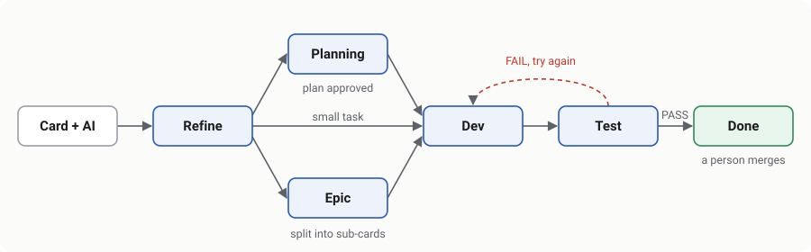

# AI Agent Developer

> **Why the commit history is so short:** this project was one part of a larger system I worked on during my
> internship. The original repository belongs to the company and its code is private, so I couldn't bring the
> full history with me. What's here is the part I'm allowed to keep, cleaned of anything internal and committed
> to this repository recently.

This project lets you write a task on a Trello card and get back a code change on its own Git branch, already
reviewed by an AI. I built it during a 2026 internship. The developers on my team kept getting small bug
reports and feature requests that took more time to read and understand than to fix, and I wanted to see how
much of that work a group of AI agents could take over.

Over two weeks it handled 19 real requests on an internal company project. In full-auto mode, one card went
from "just created" to "reviewed and ready to merge" in about seven and a half minutes, and nobody touched it
along the way.

## How it works

Everything starts on a Trello board. You write a card the way you would for a colleague, maybe just a sentence
like "the suggestions section doesn't save", and you add the label `AI`. Each list on the board is a stage, so
whatever list the card sits in tells the system what to do with it next.

The first stop is **Refine**. A cheap triage step reads the card and decides how big the job is. If it's tiny,
like changing a label or a colour, the card goes straight to development. Otherwise a business-analyst agent
rewrites the card into clear requirements, plus a list of acceptance criteria you can actually check. If you
also add the label `BA kỹ thuật`, a second agent reads the code and adds the technical details. I made that
step optional on purpose: when the review later checks the work against a technical spec, it fails good
solutions that just took a different route.

From there the card goes one of three ways. Small tasks go to **Dev**. Tasks that need some design go to
**Planning** first, where an agent writes a plan and a person approves it with the `plan approve` label. Very
large features go to **Epic**, where the plan is split into a series of smaller cards on a shared integration
branch, and those cards are worked through one after another.

In **Dev**, the system starts Claude Code in a separate Git worktree, so it never touches your working copy.
Claude Code makes the change and commits it on a `feature/...` branch.

Then the card moves to **Test**. Here a review agent opens the changed files and the code around them, not just
the diff, and checks each acceptance criterion one by one. It answers with PASS, FAIL, or NEEDS_INFO, and every
problem it reports comes with a file and line number. NEEDS_INFO is for cases where it really can't tell, for
example when the answer depends on configuration or data it can't see. I added that because a reviewer that
guesses is worse than one that asks. On FAIL, the card goes back to Dev with the review attached and gets
another try.

Nothing is ever merged automatically. When a card passes, it lands in **Done** and a person merges the branch.



The picture above is only a rough sketch. The text is the real description.

There are two ways to run the board. Normally a person drags cards from list to list. If you turn on
**full-auto** for a board (the robot button in the admin page), the agents move the card themselves after each
step. In full-auto a card that keeps failing is stopped after a few attempts and waits for a human, so it can't
loop forever.

The same Test stage also works for code a person wrote. Push your branch, put `Branch: your-branch` in the card
description, and drag the card to Test. The agent reviews that branch without changing anything. The next time
you do it, it only looks at the commits added since its last review.

## Lessons and limits

- **Cost.** One agent reading the whole repo per card burned through tokens, so I split the work into cheap
  triage, a business analyst, and an optional technical step, plus a grep-built index of the repo. Token use is
  logged per stage, which showed that review is the expensive part (about 2.2M of 2.8M input tokens in one run).
- **Reliability.** Projects run in separate worker processes, Git commands are locked per repo so parallel
  cards don't collide, and the Claude CLI client retries when the JSON is missing.
- **Not done yet.** The reviewer reads code but doesn't run tests, and Trello is polled every 30 seconds
  because the webhook server needs a public URL.

## Running it yourself

You'll need Node.js 20 or newer, Git, and a way to talk to Claude. That means either Claude Code installed and
logged in (run `claude`, then `/login`), or an Anthropic API key. You also need a Trello account with an API key
and token, which you can get at <https://trello.com/app-key>, and a repo cloned on the same machine for the
agents to work on. The Trello account that made the token has to be a member of the board.

Clone the project, install it, and make your own settings file:

```bash
git clone https://github.com/Shicukoe/AI-Agent-Developer.git
cd AI-Agent-Developer
npm install
cp .env.example .env
```

Open `.env` and fill in at least these lines. The repo path is only a fallback until you connect a board in
the admin page. The worktree folder should sit outside your target repo. The admin token can be any long
random string, and setting it is what turns the admin page on.

```ini
TRELLO_API_KEY=...
TRELLO_API_TOKEN=...
GIT_REPO_PATH=D:\path\to\target-repo
GIT_WORKTREE_BASE=D:\path\to\agent-worktrees
GIT_DEFAULT_BASE_BRANCH=main
ADMIN_API_TOKEN=pick-a-long-random-string
```

Everything else in `.env.example` is optional. That includes choosing a different model, or even Gemini or
OpenAI, for each stage.

Start it with `npm run dev`. Then open <http://127.0.0.1:3457/admin>, log in with your admin token, and add a
project on the Repos page. You need the Trello board id (add `.json` to the end of the board's URL to find it),
a name, the local path of the repo, and the branch to work from. When you save, the system creates the lists
and labels it needs on the board, so you don't have to set them up by hand. If you want to watch it run on its
own, turn on the robot button for that board.

To try it, create a card such as "Add a dark-mode toggle to the header" and give it the `AI` label. With
full-auto on, you'll see the card move by itself and end up with a new branch in your repo and a review comment
on the card. With full-auto off, drag it to Refine, and the agent's comment will tell you where it should go
next.

One more step pays off if you plan to use it for a while. Running `npm run gen-docs -- <board_id>` writes short
business-level documents about your repo into its `docs` folder. Read them, fix anything wrong, and commit
them. The agents read these before they read code, which saves a lot of tokens on every card after that.

To check the code itself, run `npx tsc --noEmit` for types and `npm test` for the unit tests. More detail and a
troubleshooting table are in [`docs/SETUP.md`](docs/SETUP.md). That file, along with the other docs in the repo,
is in Vietnamese.

## Built with

The whole thing is TypeScript on Node.js. Claude Code does the coding, and the Anthropic SDK handles the API
calls, with Gemini and OpenAI as optional alternatives. State lives in SQLite. Each project runs as a forked
Node process that talks to a supervisor over IPC. The admin page is a small Express API with a plain HTML
dashboard.

If you're reading the code, start at `src/supervisor.ts`, which starts one worker per project, and
`src/agents/StageRouter.ts`, which decides what happens at each stage. The individual agents sit next to it in
`src/agents/`.

## Credits

A teammate started this project with the first version of the Trello and Git plumbing: the board connection,
the worktrees, the epic flow, memory kept in card comments, and an early multi-process setup. I built the agent
pipeline on top of that. That covers the triage and analyst steps, the review that checks real code, support
for many repos with one worker each, token tracking, the docs and index generation, and full-auto mode. The
commit history shows who did what.
