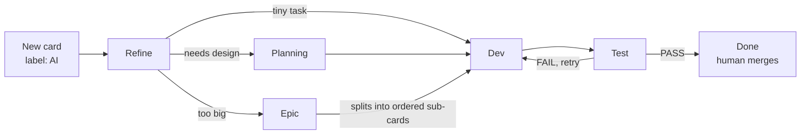

# AI Agent Developer

You write a Trello card. A team of AI agents turns it into a reviewed code change on its own Git branch.

I built this during a 2026 internship to take small bug reports and feature requests off the developers'
plate. It ran against a real internal project: 19 real requests, 47 review rounds. In full-auto mode one card
went from "new" to "reviewed and ready to merge" in about 7.5 minutes with nobody touching it.

> Docs inside the repo (`CLAUDE.md`, `docs/`) are in Vietnamese. This README is the English entry point.

---

## What happens to a card

You move a card between Trello lists. The list it sits in decides what the agent does next.



| Stage | Agent | What it does |
|---|---|---|
| **Refine** | Triage → Business Analyst → (optional) Technical Refiner | Triage is cheap: rules first, then one Haiku call. Tiny tasks skip straight to Dev. The analyst rewrites the card into clear requirements and acceptance criteria you can actually check. |
| **Planning** | Planner | Writes an implementation plan. A human approves it with the `plan approve` label. |
| **Epic** | Planner + EpicManager | Splits a big feature into ordered sub-cards on an integration branch. Each sub-card goes through Dev → Test. |
| **Dev** | DevAgent | Runs Claude Code inside its own Git worktree and commits on a feature branch. It never touches your working copy. |
| **Test** | ReviewAgent | Opens the changed code (not just the diff) and checks every acceptance criterion. Returns **PASS / FAIL / NEEDS_INFO** with `file:line` for each problem. |

**Full-auto mode** (the 🤖 toggle per board in the admin page): add the `AI` label and walk away. Agents move
the card through every stage. A FAIL goes back to Dev up to `MAX_DEV_RETRY_ATTEMPTS` times, then it stops and
waits for a human. Nothing is ever merged automatically.

**Reviewing human code too.** Push your own branch, drop the card in **Test**, and the agent reviews it
read-only. Put `Branch: feature/x` in the card description and it only reviews commits since its last review
of that branch.

---

## Problems I had to solve

- **Token cost.** One big "understand everything" agent was too expensive. I split it into a cheap triage
  step, a business-only analyst, and a technical refiner that only runs when you ask for it. I also built a
  static repo index (plain grep, zero LLM tokens), so agents look up "where is X" instead of searching every
  time. Per-stage token usage is recorded and shown in the admin page.
- **Reviews that pass too easily.** Reading a diff alone misses a lot. The reviewer gets `Read/Glob/Grep` on
  the real worktree and must verify each criterion. When it can't decide, for example because the answer
  depends on config or runtime data it can't see, it says NEEDS_INFO instead of guessing.
- **Many projects, one install.** Each Trello board maps to one repo. The supervisor forks **one worker
  process per project**, so a crash in one project never stops the others. Workers restart with backoff.
- **Parallel cards in the same repo.** Git commands like `fetch` and `worktree add` collide when they run at
  the same time. A per-repo lock makes only those short Git steps run one by one. The slow LLM work still runs
  in parallel.
- **Double processing.** In full-auto, moving a card and the poller seeing that move can fire the same job
  twice. A status guard plus an in-memory set of running jobs closes that gap.
- **A flaky CLI.** Claude CLI sometimes hangs after finishing, or replies without JSON. The client kills the
  process as soon as the `result` event arrives, retries up to 2 times when JSON is missing, and the analyst
  steps fall back to the raw card so one bad call doesn't kill the task.

---

## Real numbers

From the SQLite database after two weeks on a real project:

- 19 tasks across 3 boards, 47 review rounds: 13 PASS, 30 FAIL, 4 NEEDS_INFO. Most tasks went through a few
  FAIL → fix rounds before passing, so the review loop was catching real problems.
- Token use for one full-auto card. Cost is the API-price equivalent; it actually ran on a Claude
  subscription through the CLI.

| Stage | Input tokens | Cost |
|---|---|---|
| Triage (Haiku) | 16k | $0.03 |
| Business analyst | 292k | $1.22 |
| Dev | 266k | $0.88 |
| Review | 2.25M | $5.51 |

About 95% of input tokens were prompt-cache reads. Review is clearly the expensive part, so that is where I
would optimise next.

---

## Honest limits

- The reviewer **reads** code. It does not run the test suite. Running tests in a sandbox is the next step.
- Claude CLI can be slow or flaky on big repos. Setting `ANTHROPIC_API_KEY` sends the JSON steps through the
  API, which is more stable.
- Polling Trello every 30 s is simple and works, but it is not instant. A webhook server exists but needs a
  public URL.

---

## Run it yourself

### 1. What you need

- **Node.js 20+** and Git
- **Claude**: either the Claude CLI logged in (`claude`, then `/login`), or an `ANTHROPIC_API_KEY`. The Dev
  stage always uses the CLI.
- A **Trello** account, plus an API key and token from <https://trello.com/app-key>. The account that owns the
  token must be a member of the board.
- A **target repo** cloned on the same machine. That's the repo the agents will change.

### 2. Install

```bash
git clone https://github.com/Shicukoe/AI-Agent-Developer.git
cd AI-Agent-Developer
npm install
cp .env.example .env
```

### 3. Fill in `.env`

The minimum:

```ini
TRELLO_API_KEY=...
TRELLO_API_TOKEN=...

GIT_REPO_PATH=D:\path\to\target-repo          # used only until you map a board in the admin page
GIT_WORKTREE_BASE=D:\path\to\agent-worktrees  # outside the target repo
GIT_DEFAULT_BASE_BRANCH=main

ADMIN_API_TOKEN=pick-a-long-random-string     # turns the admin page on

# Optional, more stable than the CLI for the JSON steps
# ANTHROPIC_API_KEY=sk-ant-...
```

Every other option, including picking a different model or provider per stage, is listed in `.env.example`.

### 4. Start it and connect a board

```bash
npm run dev
```

1. Open <http://127.0.0.1:3457/admin> and log in with your `ADMIN_API_TOKEN`.
2. Go to **Repos** and add a project: Trello board id, a name, the local repo path, and the base branch.
   You can get the board id by adding `.json` to the board URL.
3. Click save. The agent creates the lists (`Refine, Planning, Dev, Test, Epic, Done, Info, Docs`) and labels
   (`AI`, `plan approve`, `quick`, `BA kỹ thuật`) on the board for you.
4. Optional: turn on 🤖 full-auto for that board.

### 5. Try one card

Create a card such as *"Add a dark-mode toggle to the header"* and give it the `AI` label.

- **Full-auto on:** watch it move by itself. The result is a branch `feature/...` in the target repo and a
  review comment on the card.
- **Full-auto off:** drag the card to **Refine**. The agent comments which list comes next: **Dev** for small
  tasks, or **Planning**, where you approve the plan with the `plan approve` label. After Dev, drag it to
  **Test**.

### 6. Optional: give the agents project docs

```bash
npm run gen-docs -- <board_id>
```

This writes business-level docs to `<repo>/docs`. Review them and commit them. Agents read these before
reading code, which saves a lot of tokens on later cards.

### Checks

```bash
npx tsc --noEmit   # type check
npm test           # unit tests (vitest)
```

More detail, including troubleshooting, is in [`docs/SETUP.md`](docs/SETUP.md) (Vietnamese).

---

## Tech stack

TypeScript (strict, ESM) on Node.js · Claude Code CLI and Anthropic SDK, with optional Gemini and OpenAI ·
SQLite (`better-sqlite3`, WAL mode) · `child_process` fork + IPC for workers · p-queue · Express for the admin
API · Git worktrees · Zod · Pino · Vitest

## Where things live

| Path | What's there |
|---|---|
| `src/supervisor.ts`, `src/worker.ts` | Entry point. One worker process per project |
| `src/agents/StageRouter.ts` | Decides what happens in each stage, including full-auto |
| `src/agents/*Agent.ts` | Triage, analysts, planner, dev, review, index |
| `src/claude/` | LLM client (Claude CLI / API / Gemini / OpenAI), prompts |
| `src/git/` | Git and worktree helpers, with per-repo locking |
| `src/state/` | SQLite schema and repositories |
| `src/admin/`, `public/admin/` | Admin API and dashboard |

## Safety rails

- Agents only commit inside their own worktree. Reviewing human branches is read-only.
- Merging into protected branches (`main`, `master`, `dev`, `develop`, `staging`, `production`) is blocked
  in code.
- Shell commands go through an allowlist. The Dev agent has no shell access at all.
- A task with no heartbeat for `MAX_TASK_PROCESSING_MINUTES` is stopped automatically.

## Credits

A teammate started the original Trello → Git scaffold: the connector, worktrees, epic flow and card-comment
memory, and a first multi-process version. I built the agent pipeline on top of it: triage and analysts,
verification review, multi-repo support with one worker per project, token tracking, docs and index
generation, and full-auto mode. The commit history shows who did what.
